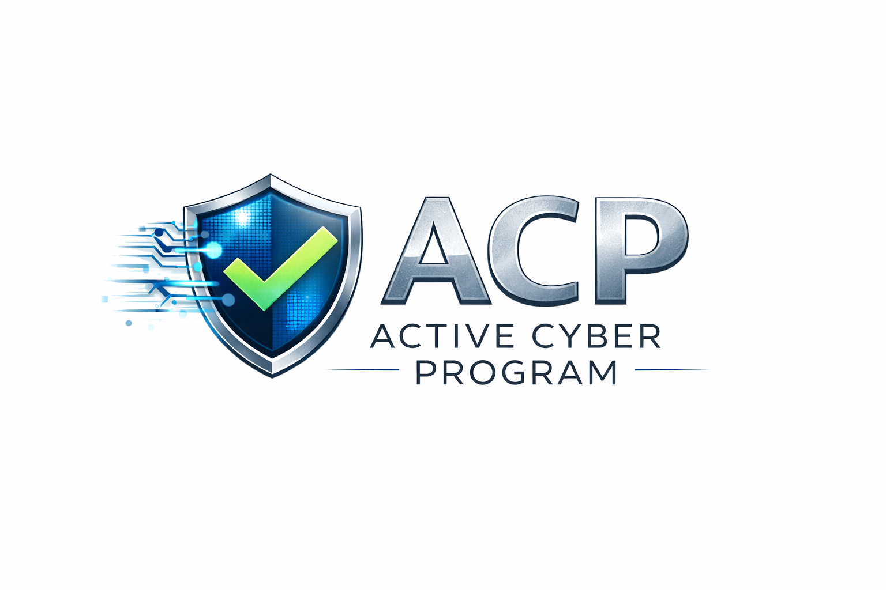
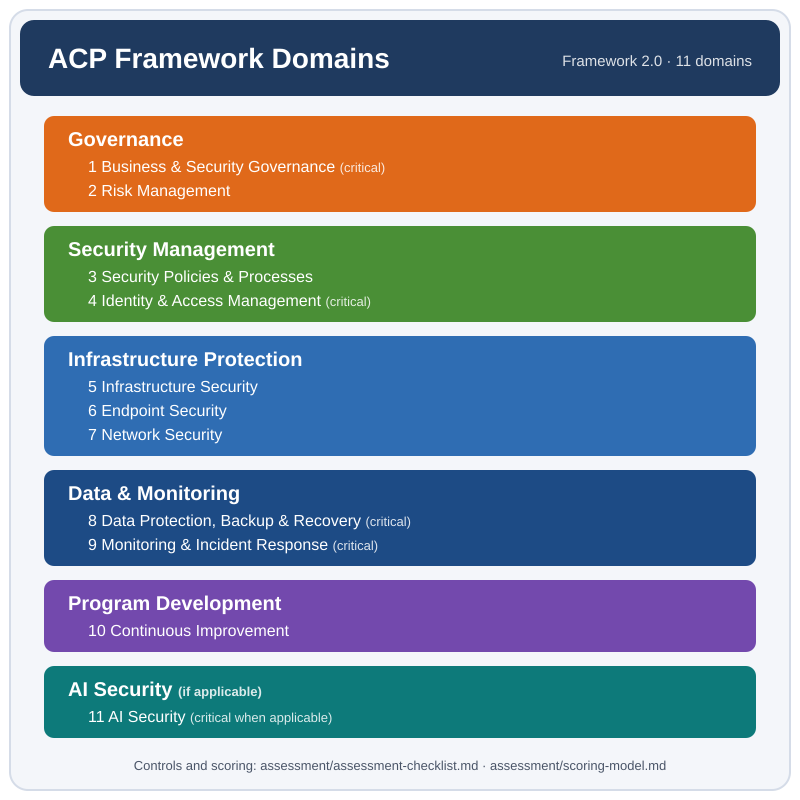

<!-- translation-of: README.md | source-sha256: 42852f6b3737217b -->
# Active Cyber Program (ACP)

[English](README.md) | **Deutsch**


[](https://acp.videotrainer.ch/)



> Übersetzung der englischen Fassung ([README.md](README.md)). Bei Abweichungen gilt die englische Fassung. Die verlinkten Detaildokumente sind, wo nicht anders angegeben, auf Englisch.

# Über das Active Cyber Program (ACP)

Das **Active Cyber Program (ACP)** ist ein Framework für Cybersecurity-Assessments und -Zertifizierungen. Es beurteilt, ob eine Organisation ein **aktives und wirksames Cybersecurity-Programm** betreibt.

Das ACP-Framework prüft, ob Cybersecurity **nicht nur umgesetzt, sondern aktiv gesteuert** wird, und zwar in der Governance, in den betrieblichen Prozessen und in der technischen Infrastruktur.

Das Framework bietet Organisationen eine strukturierte Methode, um ihre Cybersecurity-Fähigkeiten zu beurteilen, zu verbessern und nachzuweisen.

---

# Überblick über das ACP-Framework

<p align="center">
  
</p>

---

# Framework-Version

Aktuelle Framework-Version:

**ACP Framework Version 1.6**

Informationen zur Version finden Sie in:

* `VERSION`
* `CHANGELOG.md` (Englisch)

---

# Zweck des Frameworks

Viele Organisationen setzen Sicherheitstechnologien ein, haben aber kein **strukturiertes und aktiv gesteuertes Cybersecurity-Programm**.

Das **Active Cyber Program (ACP)** hilft Organisationen dabei:

* eine strukturierte Cybersecurity-Governance aufzubauen
* Cyberrisiken wirksam zu steuern
* betriebliche Sicherheitsprozesse umzusetzen
* technische Schutzmassnahmen zu stärken
* den Cybersecurity-Reifegrad laufend zu verbessern

Das Framework bietet einen **praxisnahen und skalierbaren Ansatz** für Organisationen unterschiedlicher Grösse und Branche.

---

# ACP-Zertifizierung

Organisationen, die die ACP-Anforderungen erfüllen, können folgende Zertifizierung erhalten:

**Active Cyber Program (ACP) Certification**

Die Zertifizierung bestätigt, dass die Organisation ein **strukturiertes und aktiv gesteuertes Cybersecurity-Programm** betreibt.

Zertifizierte Organisationen dürfen das **ACP Trust Label** verwenden, um ihr Engagement für Cybersecurity gegenüber Kunden und Partnern zu zeigen.

---

# Zertifizierungsstelle

Die **ACP-Zertifizierung** darf ausschliesslich ausgestellt werden von:

**Wechsler Information Solution**

Das ACP-Framework wird veröffentlicht, um Transparenz zu schaffen und die Cybersecurity-Praxis zu verbessern.

Organisationen dürfen das Framework verwenden für:

* interne Cybersecurity-Assessments
* Initiativen zur Verbesserung der Cybersecurity
* Ausbildungszwecke

Organisationen oder Einzelpersonen dürfen jedoch **keine ACP-Zertifizierungen ausstellen** und sich nicht als offizielle ACP-Zertifizierungsstelle ausgeben.

Nur Assessments, die im Auftrag von **Wechsler Information Solution** durchgeführt werden, können zu einer offiziellen **Active Cyber Program Certification** führen.

Siehe:
`docs/governance.md`

[Governance](./docs/governance.md) (Englisch)

---

# Selbstbewertung

Organisationen können das **Active Cyber Program (ACP)** eigenständig anwenden, um ihre Cybersecurity-Lage zu beurteilen. Der Einstieg ist einfach.

## Web-App zur ACP-Selbstbewertung

Am einfachsten starten Sie mit der kostenlosen Web-App unter **[acp.videotrainer.ch](https://acp.videotrainer.ch/)**:

* keine Anmeldung, keine Cookies, keine Datenspeicherung: Alle Eingaben bleiben in Ihrem Browser
* alle ACP-Controls mit Leitfragen und Bewertungshilfe
* sofortiges Ergebnis: Gesamtscore, Reifegrad, Scores pro Domäne, Knock-out-Controls und Handlungsfelder

Das Ergebnis ist eine Selbsteinschätzung ohne Prüfung von Nachweisen und keine ACP-Zertifizierung. Der Quellcode ist öffentlich: [github.com/tomwechsler/acp-app](https://github.com/tomwechsler/acp-app).

## Leitfaden zur Selbstbewertung

Der Leitfaden zur Selbstbewertung erklärt Schritt für Schritt, wie Sie:

• den Scope des Assessments festlegen  
• die Cybersecurity-Controls bewerten  
• Nachweise sammeln  
• Scores berechnen  
• Verbesserungsbereiche identifizieren  

Siehe:
`docs/self-assessment-guide.md`

[Leitfaden zur Selbstbewertung](./docs/self-assessment-guide.md) (Englisch)

Für die Durchführung steht der Fragenkatalog auf Deutsch zur Verfügung:

* [ACP-Fragenkatalog (Markdown)](./assessment/assessment-questionnaire.de.md)
* [ACP-Fragenkatalog (PDF)](./templates/acp-assessment-questionnaire-de.pdf)

---

# Bestandteile des ACP-Frameworks

Das ACP-Framework besteht aus mehreren Kernkomponenten.

## ACP-Prinzipien

Die ACP-Prinzipien beschreiben die Grundhaltung des Frameworks und betonen die aktive Steuerung der Cybersecurity.

`framework/acp-principles.md`

[ACP-Prinzipien](./framework/acp-principles.md) (Englisch)

---

## Control-Domänen

Das Framework definiert elf Control-Domänen, die Governance, betriebliche Prozesse und technische Sicherheitsmassnahmen abdecken.

`framework/control-domains.md`

[Control-Domänen](./framework/control-domains.md) (Englisch)

---

## Reifegradmodell

Das ACP-Reifegradmodell beurteilt, wie wirksam Cybersecurity-Praktiken umgesetzt sind.

`framework/maturity-levels.md`

[Reifegradmodell](./framework/maturity-levels.md) (Englisch)

---

## Control-Mapping

Alle ACP-Controls sind NIS2, ISO/IEC 27001:2022, dem NIST Cybersecurity Framework 2.0 und für die KI-Sicherheit dem NIST AI Risk Management Framework zugeordnet. Das Mapping führt auch die Themen auf, die ACP nicht abdeckt, gibt einen Überblick über die vom ACP abgedeckten Kategorien des NIST CSF 2.0 und enthält einen Hinweis zum IKT-Minimalstandard des Bundes.

`framework/control-mapping.md`

[Control-Mapping](./framework/control-mapping.md) (Englisch)

---

# Assessment-Methodik

Das ACP-Framework enthält eine strukturierte Methodik zur Beurteilung von Cybersecurity-Programmen.

Assessment-Prozess:

`docs/assessment-process.md`

[Assessment-Prozess](./docs/assessment-process.md) (Englisch)

Assessment-Werkzeuge:

* `assessment/assessment-checklist.md` [Assessment-Checkliste](./assessment/assessment-checklist.md) (Englisch)
* `assessment/evidence-requirements.md` [Anforderungen an Nachweise](./assessment/evidence-requirements.md) (Englisch)
* `assessment/scoring-model.md` [Scoring-Modell](./assessment/scoring-model.md) (Englisch)
* `assessment/assessment-questionnaire.de.md` [ACP-Fragenkatalog](./assessment/assessment-questionnaire.de.md) (PDF: [templates/acp-assessment-questionnaire-de.pdf](./templates/acp-assessment-questionnaire-de.pdf))
* Englische Fassung des Fragenkatalogs: [assessment/assessment-questionnaire.md](./assessment/assessment-questionnaire.md) (PDF: [templates/acp-assessment-questionnaire.pdf](./templates/acp-assessment-questionnaire.pdf))

---

# Zertifizierungsprogramm

Das ACP-Zertifizierungsprogramm legt fest, wie Organisationen beurteilt und zertifiziert werden.

Zertifizierungsregeln:

`docs/certification.md`

[Zertifizierungsprogramm](./docs/certification.md) (Englisch)

Verwendung des Trust Labels:

`docs/trust-label.md`

[Trust Label](./docs/trust-label.md) (Englisch)

---

# Governance

Das ACP-Framework wird von **Wechsler Information Solution** gepflegt und verwaltet.

Dokumentation zur Governance:

`docs/governance.md`

[Governance](./docs/governance.md) (Englisch)

---

# Zielgruppen

Das ACP-Framework richtet sich an Organisationen jeder Grösse, darunter:

* kleine und mittlere Unternehmen (KMU)
* Technologieunternehmen
* Dienstleister
* öffentliche Verwaltungen
* Zulieferer in sicherheitskritischen Branchen

Das Framework ist **praxisnah, skalierbar und branchenübergreifend anwendbar**.

---

# Aufbau des Repositorys

```
active-cyber-program/

README.md
README.de.md
VERSION
CHANGELOG.md
SECURITY.md
LICENSE

docs/
   overview.md
   methodology.md
   assessment-process.md
   self-assessment-guide.md
   certification.md
   certification-process.md
   trust-label.md
   trademark.md
   governance.md
   author.md

framework/
   acp-principles.md
   control-domains.md
   maturity-levels.md
   control-mapping.md

assessment/
   assessment-checklist.md
   evidence-requirements.md
   scoring-model.md
   assessment-questionnaire.md
   assessment-questionnaire.de.md

templates/
   assessment-report-template.md
   certification-template.md
   improvement-plan-template.md
   acp-assessment-questionnaire.pdf
   acp-assessment-questionnaire-de.pdf

examples/
   example-assessment.md
   example-certification.md

certifications/
   registry.md

legal/
   acp-assessment-agreement-template.md

assets/
   acp-logo.png
   acp-framework-diagram.svg
   acp-trust-label.svg

tools/
   build-questionnaire-pdf.py
   check-translations.py
```

---

# Herausgeber

**Wechsler Information Solution, Tom Wechsler, Schweiz**

Hofackerstrasse 8, 4625 Oberbuchsiten, Schweiz

Für Organisationen in Deutschland • Schweiz • Österreich

Autor des Frameworks: Tom Wechsler  

Kontakt: [training@videotrainer.ch](mailto:training@videotrainer.ch)

Siehe: `docs/author.md`

[Autor](./docs/author.md) (Englisch)

## Über die ACP-Initiative

Das Active Cyber Program (ACP) wurde geschaffen, um praxisnah und transparent zu beurteilen, ob Organisationen ein **aktives Cybersecurity-Programm** betreiben.

---

# Weiterentwicklung

Cybersecurity entwickelt sich laufend weiter.

Das ACP-Framework wird deshalb weiterentwickelt auf Basis von:

* neuen Cyberbedrohungen
* Erfahrungen aus Assessments
* Verbesserungen in der Sicherheitspraxis
* Rückmeldungen von Organisationen

Neue Framework-Versionen können periodisch veröffentlicht werden.

---

# Lizenz

Die Dokumentation des ACP-Frameworks steht unter der Lizenz [Creative Commons Namensnennung – Keine Bearbeitungen 4.0 International (CC BY-ND 4.0)](https://creativecommons.org/licenses/by-nd/4.0/deed.de).

* Sie dürfen das unveränderte Framework für jeden Zweck mit Namensnennung weitergeben.
* Organisationen und Assessoren dürfen die Vorlagen, den Fragenkatalog und die Checkliste für ihre eigenen Assessments ausfüllen, ergänzen und weitergeben (zusätzliche Erlaubnis, siehe `LICENSE`).
* Veränderte Fassungen des Frameworks selbst dürfen nicht verbreitet werden.

Die Namen «Active Cyber Program» und «ACP», das ACP-Logo, die ACP-Zertifizierung und das ACP Trust Label sind von dieser Lizenz nicht erfasst. Ihre Verwendung regelt die [Richtlinie zur Verwendung von Marke und Zertifizierung](./docs/trademark.md) (Englisch).

Massgeblich ist der englische Lizenztext: [LICENSE](./LICENSE).
