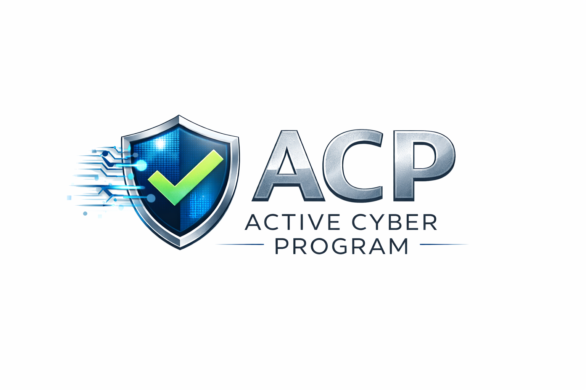

<!-- translation-of: README.md | source-sha256: 302f8a764b87544d -->
<p align="center">
  
</p>

<h1 align="center">Active Cyber Program (ACP)</h1>

<p align="center">
  <a href="README.md">English</a> | <strong>Deutsch</strong>
</p>

<p align="center">
  Ein praxisnahes Framework, mit dem Organisationen den Stand ihrer Cybersecurity bewerten, zeigen und verbessern.<br>
  74 Controls in 11 Domänen, ein einfaches Bewertungsmodell und eine optionale Zertifizierung.
</p>

<p align="center">
  <a href="https://acp.videotrainer.ch/"></a>
</p>

<p align="center">
  
  
  
  
</p>

> Übersetzung der englischen Fassung ([README.md](README.md)). Bei Abweichungen gilt die englische Fassung. Die verlinkten Detaildokumente sind, wo nicht anders angegeben, auf Englisch.

ACP beurteilt, ob eine Organisation ein **aktives** Cybersecurity-Programm betreibt: nicht nur, ob Sicherheitsmassnahmen vorhanden sind, sondern ob sie angewendet, überprüft und verbessert werden. Kleine Organisationen brauchen keine umfangreiche Dokumentation. Kurze, klare Regeln genügen, wenn sie gelebt werden und gezeigt werden können.

---

## Was ACP Ihnen bringt

**Geschäftsleitungen und CEOs**

* Sie sehen auch ohne IT-Wissen, was umgesetzt ist, wo Lücken bestehen und ob die wichtigsten Schutzmassnahmen wie Multi-Faktor-Authentifizierung, Patching und Backups vorhanden sind.
* Sie sehen, was mit dem Cybersecurity-Budget erreicht wurde und wo die nächste Investition am meisten bewirkt.

**IT-Verantwortliche**

* Sie zeigen der Geschäftsleitung den Stand der Cybersecurity und die nächsten Schritte auf einer klaren und strukturierten Grundlage.
* Sie setzen Prioritäten: Knock-out-Controls und kritische Domänen zuerst.

**IT-Dienstleister**

* Sie zeigen Ihren Kunden Control für Control, dass die vereinbarten Sicherheitsmassnahmen umgesetzt sind und funktionieren, mit Nachweisen wie MFA-Einstellungen, Patch-Berichten oder Restore-Tests.
* Sie arbeiten mit einem gemeinsamen Massstab statt mit eigenen Checklisten, zugeordnet zu ISO/IEC 27001, NIS2 und NIST CSF 2.0.

ACP zeigt den Umsetzungsstand der Cybersecurity. Es prüft nicht jede einzelne Konfigurationseinstellung, misst weder Kosten noch Wirtschaftlichkeit und garantiert nicht, dass keine Sicherheitsvorfälle eintreten.

---

## So starten Sie

Wie viel ein Resultat belegt, hängt davon ab, wie es entstanden ist:

| Stufe | Was es ist | Was es zeigt |
| ----- | ---------- | ------------ |
| Selbstbewertung | Ihre eigene Einschätzung, zum Beispiel mit der kostenlosen [Web-App](https://acp.videotrainer.ch/) | Einen Überblick und eine Gesprächsgrundlage, keinen Beweis |
| Selbstbewertung mit Nachweisen | Die Nachweise, die im [Fragenkatalog](./assessment/assessment-questionnaire.de.md) unter «Zeigen lassen» stehen, werden pro Control vorgelegt | Ein Resultat, das die andere Seite überprüfen kann, aber keine unabhängige Prüfung |
| Offizielles ACP-Assessment | Ein autorisierter Assessor prüft die Nachweise | Ein unabhängig geprüftes Resultat und, wenn die Anforderungen erfüllt sind, die ACP-Zertifizierung |

Die [Web-App](https://acp.videotrainer.ch/) braucht keine Anmeldung und verwendet keine Cookies. Alle Eingaben bleiben in Ihrem Browser und werden nicht gespeichert. Das Resultat können Sie als PDF sichern, einen Zwischenstand als Datei auf Ihrem eigenen Gerät, um ihn später wieder zu laden. Der Quellcode ist öffentlich: [github.com/tomwechsler/acp-app](https://github.com/tomwechsler/acp-app).

Schritt für Schritt hilft der [Leitfaden zur Selbstbewertung](./docs/self-assessment-guide.de.md). Die nächsten Schritte planen Sie mit dem [Massnahmenplan](./templates/improvement-plan-template.de.md).

---

## Was ACP prüft

| Domäne | Controls | Kritisch |
| ------ | -------- | -------- |
| 1. Unternehmens- und Sicherheits-Governance | 6 | Ja |
| 2. Risikomanagement | 6 | |
| 3. Sicherheitsrichtlinien und -prozesse | 7 | |
| 4. Identitäts- und Zugriffsmanagement | 6 | Ja |
| 5. Infrastruktursicherheit | 7 | |
| 6. Endgerätesicherheit | 6 | |
| 7. Netzwerksicherheit | 7 | |
| 8. Datensicherheit, Backup und Wiederherstellung | 8 | Ja |
| 9. Monitoring und Vorfallbehandlung | 6 | Ja |
| 10. Kontinuierliche Verbesserung | 6 | |
| 11. KI-Sicherheit (wenn KI genutzt wird) | 9 | Ja, wenn anwendbar |

Jedes Control wird von 0 (nicht umgesetzt) bis 3 (aktiv gesteuert) bewertet. Für eine Zertifizierung braucht es einen Gesamtscore von mindestens 2.00, mindestens 2.00 in jeder kritischen Domäne und keinen Score 0 bei den sechs Knock-out-Controls: Multi-Faktor-Authentifizierung, privilegierte Konten, Patching, Backups, Schutz der Backups und Incident Response.

Die Controls sind NIS2, ISO/IEC 27001:2022 und NIST CSF 2.0 zugeordnet, für die KI-Sicherheit dem NIST AI RMF, ISO/IEC 42001 und den OWASP-Top-10-Listen. Das [Control-Mapping](./framework/control-mapping.md) führt auch die Themen auf, die ACP nicht abdeckt.

---

## Zertifizierung

Organisationen, die die Anforderungen erfüllen, erhalten die ACP-Zertifizierung für 24 Monate und dürfen das ACP Trust Label verwenden. In dieser Zeit reichen sie eine jährliche Bestätigung ein und melden wesentliche Änderungen und Sicherheitsvorfälle.

Die ACP-Zertifizierung stellt ausschliesslich Wechsler Information Solution aus. Sie ist nicht akkreditiert und ist weder eine ISO/IEC-27001-Zertifizierung noch ein Nachweis der NIS2-Konformität. Alle dürfen das Framework für interne Assessments nutzen, aber keine ACP-Zertifizierungen ausstellen.

[Ablauf von Assessment und Zertifizierung](./docs/assessment-process.md) · [Zertifizierungsregeln](./docs/certification.md) · [Trust Label](./docs/trust-label.md) · [Zertifizierungsregister](./certifications/registry.md)

---

## Dokumente

| Thema | Dokumente |
| ----- | --------- |
| Überblick | [Framework-Übersicht und Methodik](./docs/overview.md) · [Prinzipien](./framework/acp-principles.md) · [Control-Domänen](./framework/control-domains.md) · [Reifegrade](./framework/maturity-levels.md) |
| Assessment | [Checkliste](./assessment/assessment-checklist.md) (massgebende Liste der Controls) · [Fragenkatalog](./assessment/assessment-questionnaire.de.md) auf Deutsch ([PDF](./templates/acp-assessment-questionnaire-de.pdf), Englisch: [Markdown](./assessment/assessment-questionnaire.md), [PDF](./templates/acp-assessment-questionnaire.pdf)) · [Scoring-Modell](./assessment/scoring-model.md) · [Anforderungen an Nachweise](./assessment/evidence-requirements.md) |
| Standards | [Control-Mapping](./framework/control-mapping.md): NIS2, ISO/IEC 27001, NIST CSF 2.0, NIST AI RMF, ISO/IEC 42001, OWASP, ISO/IEC 27090, DORA |
| Selbstbewertung | [Leitfaden zur Selbstbewertung](./docs/self-assessment-guide.de.md) auf Deutsch ([Englisch](./docs/self-assessment-guide.md)) · [Massnahmenplan](./templates/improvement-plan-template.de.md) auf Deutsch ([Englisch](./templates/improvement-plan-template.md)) |
| Zertifizierung | [Ablauf](./docs/assessment-process.md) · [Zertifizierung](./docs/certification.md) · [Trust Label](./docs/trust-label.md) · [Nutzung von Marke und Zertifizierung](./docs/trademark.md) · [Governance](./docs/governance.md) |
| Vorlagen und Beispiele | [Assessment-Vertrag](./legal/acp-assessment-agreement-template.md) · [Assessment-Bericht](./templates/assessment-report-template.md) · [Zertifikat](./templates/certification-template.md) · [Beispiel-Assessment](./examples/example-assessment.md) · [Beispiel-Zertifikat](./examples/example-certification.md) · [Register](./certifications/registry.md) |
| Hilfe | [Häufige Fragen](./docs/faq.de.md) auf Deutsch ([Englisch](./docs/faq.md)) · [Glossar](./docs/glossary.de.md) auf Deutsch ([Englisch](./docs/glossary.md)) |

<details>
<summary>Aufbau des Repositorys</summary>

```
active-cyber-program/
├── README.md, README.de.md, VERSION, CHANGELOG.md, SECURITY.md, LICENSE
├── docs/            Übersicht, Ablauf, Leitfaden zur Selbstbewertung, Zertifizierung,
│                    Trust Label, Marke, Governance, Glossar, häufige Fragen, Autor
├── framework/       Prinzipien, Control-Domänen, Reifegrade, Control-Mapping
├── assessment/      Checkliste, Fragenkatalog, Scoring-Modell, Anforderungen an Nachweise
├── templates/       Bericht, Zertifikat, Massnahmenplan, Fragenkatalog als PDF
├── examples/        Beispiel-Assessment und -Zertifikat
├── certifications/  Zertifizierungsregister
├── legal/           Vorlage für den Assessment-Vertrag
├── assets/          Logo, Framework-Diagramm, Trust Label
└── tools/           Skripte zum Erstellen der PDFs und zum Prüfen der Übersetzungen
```

</details>

---

## Version, Feedback und Kontakt

Aktuelle Version: **ACP Framework Version 2.3**. Änderungen sind im [CHANGELOG.md](./CHANGELOG.md) (Englisch) dokumentiert. Das Framework wird auf Basis neuer Bedrohungen, der Erfahrungen aus Assessments und der Rückmeldungen aus der Praxis weiterentwickelt.

Fragen, Anregungen und Erfahrungen aus der Praxis sind willkommen: [training@videotrainer.ch](mailto:training@videotrainer.ch)

Herausgeber: **Wechsler Information Solution**, Tom Wechsler, Hofackerstrasse 8, 4625 Oberbuchsiten, Schweiz. Für Organisationen in Deutschland, der Schweiz und Österreich. [Über den Autor](./docs/author.md)

---

## Lizenz

Die Dokumentation des ACP-Frameworks steht unter der Lizenz [Creative Commons Namensnennung – Keine Bearbeitungen 4.0 International (CC BY-ND 4.0)](https://creativecommons.org/licenses/by-nd/4.0/deed.de).

* Sie dürfen das unveränderte Framework für jeden Zweck mit Namensnennung weitergeben.
* Organisationen und Assessoren dürfen die Vorlagen, den Fragenkatalog und die Checkliste für ihre eigenen Assessments ausfüllen, ergänzen und weitergeben (zusätzliche Erlaubnis, siehe `LICENSE`).
* Veränderte Fassungen des Frameworks selbst dürfen nicht verbreitet werden.
* Die Skripte in `tools/` sind von dieser Lizenz nicht erfasst. Sie dürfen ausgeführt werden, um dieses Repository zu erstellen und zu prüfen; alle weiteren Rechte sind vorbehalten.

Die Namen «Active Cyber Program» und «ACP», das ACP-Logo, die ACP-Zertifizierung und das ACP Trust Label sind von dieser Lizenz nicht erfasst. Ihre Verwendung regelt die [Richtlinie zur Verwendung von Marke und Zertifizierung](./docs/trademark.md) (Englisch).

Massgeblich ist der englische Lizenztext: [LICENSE](./LICENSE).
