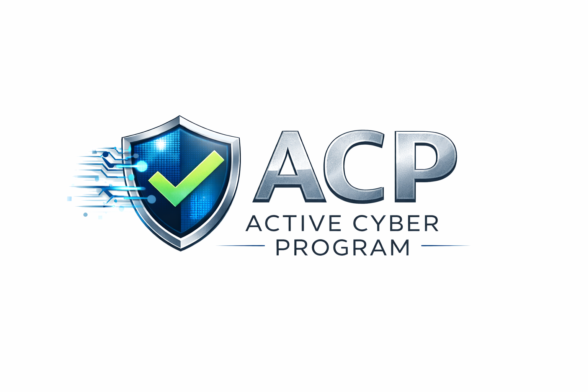

<p align="center">
  
</p>

<h1 align="center">Active Cyber Program (ACP)</h1>

<p align="center">
  <strong>English</strong> | <a href="README.de.md">Deutsch</a>
</p>

<p align="center">
  A practical framework for assessing, demonstrating and improving the state of cybersecurity in an organization.<br>
  74 controls in 11 domains, a simple scoring model and an optional certification.
</p>

<p align="center">
  <a href="https://acp.videotrainer.ch/"></a>
</p>

<p align="center">
  
  
  
  
</p>

ACP assesses whether an organization operates an **active** cybersecurity program: not only whether security measures exist, but whether they are applied, checked and improved. Small organizations do not need extensive documentation. Short, clear rules are sufficient if they are applied in practice and can be shown.

---

## What ACP Gives You

**Management and CEOs**

* See without an IT background what has been implemented, where gaps remain and whether the most important safeguards, such as multi-factor authentication, patching and backups, are in place.
* See what the cybersecurity budget has achieved and where the next investment will have the greatest effect.

**IT managers**

* Show management the state of cybersecurity and the next steps on a clear and structured basis.
* Set priorities: knock-out controls and critical domains first.

**IT service providers**

* Show customers control by control that the agreed security measures are implemented and working, with evidence such as MFA settings, patch reports or restore tests.
* Use one common standard instead of individual checklists, mapped to ISO/IEC 27001, NIS2 and NIST CSF 2.0.

ACP shows the implementation status of cybersecurity. It does not check every individual configuration setting, does not measure costs or cost-efficiency and does not guarantee the absence of security incidents.

---

## How to Get Started

How much a result can prove depends on how it was created:

| Level | What it is | What it shows |
| ----- | ---------- | ------------- |
| Self-assessment | Your own assessment, for example with the free [web app](https://acp.videotrainer.ch/) | An overview and a basis for discussion, not proof |
| Self-assessment with evidence | The evidence listed under "Show" in the [questionnaire](./assessment/assessment-questionnaire.md) is presented for each control | A result that the other party can check, but no independent review |
| Official ACP Assessment | An authorized assessor reviews the evidence | An independently reviewed result and, if the requirements are met, the ACP Certification |

The [web app](https://acp.videotrainer.ch/) (in German) requires no registration and uses no cookies. All entries stay in your browser and are not stored. The result can be saved as a PDF, and your progress can be saved as a file on your own device and loaded again later. The source code is public: [github.com/tomwechsler/acp-app](https://github.com/tomwechsler/acp-app).

For a step-by-step approach, see the [self-assessment guide](./docs/self-assessment-guide.md). Plan the next steps with the [improvement plan](./templates/improvement-plan-template.md).

---

## What ACP Assesses

| Domain | Controls | Critical |
| ------ | -------- | -------- |
| 1. Business & Security Governance | 6 | Yes |
| 2. Risk Management | 6 | |
| 3. Security Policies & Processes | 7 | |
| 4. Identity & Access Management | 6 | Yes |
| 5. Infrastructure Security | 7 | |
| 6. Endpoint Security | 6 | |
| 7. Network Security | 7 | |
| 8. Data Protection, Backup & Recovery | 8 | Yes |
| 9. Monitoring & Incident Response | 6 | Yes |
| 10. Continuous Improvement | 6 | |
| 11. AI Security (if AI is used) | 9 | Yes, if applicable |

Each control is scored from 0 (not implemented) to 3 (actively managed). Certification requires an overall score of at least 2.00, at least 2.00 in every critical domain and no score of 0 for the six knock-out controls: multi-factor authentication, privileged accounts, patching, backups, protection of backups and incident response.

The controls are mapped to NIS2, ISO/IEC 27001:2022 and NIST CSF 2.0, and for AI security to the NIST AI RMF, ISO/IEC 42001 and the OWASP Top 10 lists. The [control mapping](./framework/control-mapping.md) also lists the topics that ACP does not cover.

---

## Certification

Organizations that meet the requirements receive the ACP Certification for 24 months and may use the ACP Trust Label. During this period, they submit an annual confirmation and report significant changes and security incidents.

The ACP Certification is issued only by Wechsler Information Solution. It is not accredited and does not constitute ISO/IEC 27001 certification or NIS2 compliance. Anyone may use the framework for internal assessments, but may not issue ACP certifications.

[Assessment and certification process](./docs/assessment-process.md) · [Certification rules](./docs/certification.md) · [Trust Label](./docs/trust-label.md) · [Certification Registry](./certifications/registry.md)

---

## Documents

| Topic | Documents |
| ----- | --------- |
| Overview | [Framework overview and methodology](./docs/overview.md) · [Principles](./framework/acp-principles.md) · [Control domains](./framework/control-domains.md) · [Maturity levels](./framework/maturity-levels.md) |
| Assessment | [Checklist](./assessment/assessment-checklist.md) (authoritative list of controls) · [Questionnaire](./assessment/assessment-questionnaire.md) ([PDF](./templates/acp-assessment-questionnaire.pdf), German: [Markdown](./assessment/assessment-questionnaire.de.md), [PDF](./templates/acp-assessment-questionnaire-de.pdf)) · [Scoring model](./assessment/scoring-model.md) · [Evidence requirements](./assessment/evidence-requirements.md) |
| Standards | [Control mapping](./framework/control-mapping.md): NIS2, ISO/IEC 27001, NIST CSF 2.0, NIST AI RMF, ISO/IEC 42001, OWASP, ISO/IEC 27090, DORA |
| Self-assessment | [Self-assessment guide](./docs/self-assessment-guide.md) ([German](./docs/self-assessment-guide.de.md)) · [Improvement plan](./templates/improvement-plan-template.md) ([German](./templates/improvement-plan-template.de.md)) |
| Certification | [Process](./docs/assessment-process.md) · [Certification](./docs/certification.md) · [Trust Label](./docs/trust-label.md) · [Trademark and certification usage](./docs/trademark.md) · [Governance](./docs/governance.md) |
| Templates and examples | [Assessment agreement](./legal/acp-assessment-agreement-template.md) · [Assessment report](./templates/assessment-report-template.md) · [Certificate](./templates/certification-template.md) · [Example assessment](./examples/example-assessment.md) · [Example certification](./examples/example-certification.md) · [Registry](./certifications/registry.md) |
| Help | [FAQ](./docs/faq.md) ([German](./docs/faq.de.md)) · [Glossary](./docs/glossary.md) ([German](./docs/glossary.de.md)) |

<details>
<summary>Repository structure</summary>

```
active-cyber-program/
├── README.md, README.de.md, VERSION, CHANGELOG.md, SECURITY.md, LICENSE
├── docs/            overview, assessment process, self-assessment guide, certification,
│                    trust label, trademark, governance, glossary, FAQ, author
├── framework/       principles, control domains, maturity levels, control mapping
├── assessment/      checklist, questionnaire, scoring model, evidence requirements
├── templates/       report, certificate, improvement plan, questionnaire PDFs
├── examples/        example assessment and certification
├── certifications/  certification registry
├── legal/           assessment agreement template
├── assets/          logo, framework diagram, trust label
└── tools/           scripts to build the PDFs and check the translations
```

</details>

---

## Version, Feedback and Contact

Current version: **ACP Framework Version 2.2**. Changes are documented in [CHANGELOG.md](./CHANGELOG.md). The framework evolves based on new threats, assessment experience and feedback from practice.

Questions, suggestions and experience from practice are welcome: [training@videotrainer.ch](mailto:training@videotrainer.ch)

Maintained by **Wechsler Information Solution**, Tom Wechsler, Hofackerstrasse 8, 4625 Oberbuchsiten, Switzerland. Serving organizations in Germany, Switzerland and Austria. [About the author](./docs/author.md)

---

## License

The ACP framework documentation is licensed under the [Creative Commons Attribution-NoDerivatives 4.0 International License (CC BY-ND 4.0)](https://creativecommons.org/licenses/by-nd/4.0/).

* You may share the unmodified framework for any purpose with attribution.
* Organizations and assessors may fill in, extend and share the templates, the assessment questionnaire and the checklist for their own assessments (additional permission, see `LICENSE`).
* Modified versions of the framework itself must not be distributed.
* The scripts in `tools/` are not covered by this license. They may be run to build and check this repository; all other rights are reserved.

The names "Active Cyber Program" and "ACP", the ACP logo, the ACP Certification and the ACP Trust Label are not covered by this license. Their use is governed by the [trademark and certification usage policy](./docs/trademark.md).

See [LICENSE](./LICENSE).
